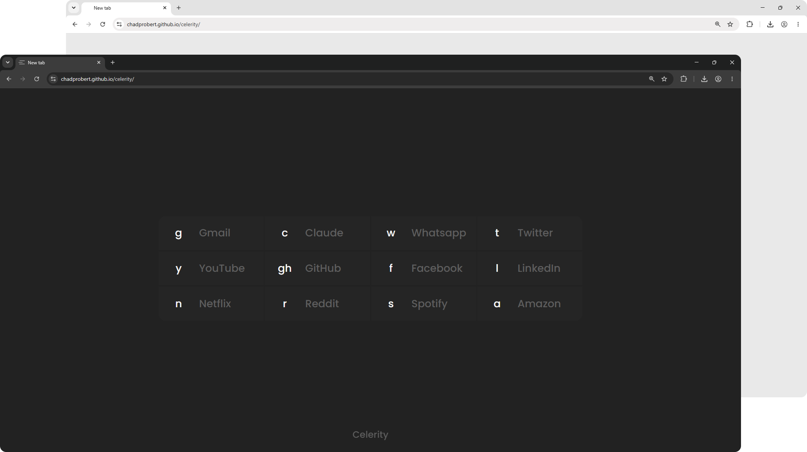

# Celerity

**Your shortcut to simpler browsing.**

Celerity turns your browser's new tab page into a keyboard-driven platform launcher. Type `y` to open YouTube, or `y focus music` to directly search YouTube for focus music. 

## Features

- **Keyboard-first navigation**  
  Launch websites with short commands.

- **Direct site search**  
  Query platforms without having to open them first.

- **Create custom shortcuts**  
  Tailor commands to match your personal workflow.

## Philosophy

Celerity is built around 3 core ideas:
  
- Good functional design is the foundation of anything genuinely pleasing.
- The interface should become invisible to the user once learned.
- A keyboard should serve as a command surface, not just text entry.
 
## Contributors

<a href="#readme-top">Back to top</a>

